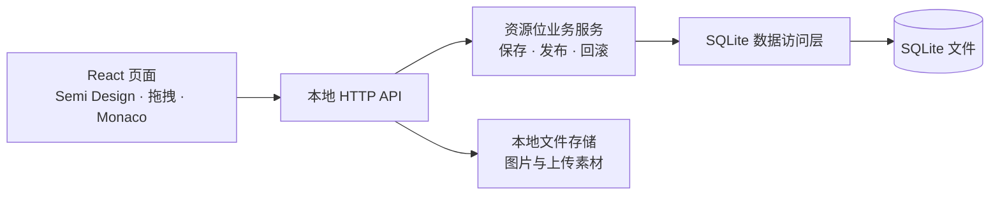

# 资源位配置与低码平台复刻技术方案

更新日期：2026-10-31

## 1. 目标与范围

### 1.1 用户明确要求

- 参考 `/Users/bytedance/tool_platform/` 的现有代码复刻资源位配置页面。
- 资源位列表页仅实现“资源位配置”Tab，以及关联的资源位低码编辑器。
- “资源位计划”Tab 和“资源位排期”Tab 不在本任务实现范围内。
- 使用 SQLite 进行数据存储。
- 使用 Vite 进行构建。
- UI 展示与原页面保持一致。
- 展示范围为资源位配置 Tab 的页面内容及关联低码编辑器，不覆盖主应用顶部导航、侧栏和业务线切换。
- 不接入真实登录、AI 推导、多语言平台和远端素材服务。
- 不处理初始业务数据，首次启动仅创建数据库结构，资源位列表从空态开始。

### 1.2 已确认的页面范围

“资源位配置”Tab 对应源码中的 `lowcode` 路由，其列表页面标题为“资源位列表”；点击“表单配置”进入关联的 `lowcode-editor/:id` 编辑器。路由对应关系见 [config-manage/src/routes.tsx](/Users/bytedance/tool_platform/apps/config-manage/src/routes.tsx)。

| 页面 | 源码入口 | 主要用途 |
| --- | --- | --- |
| 资源位配置 Tab（资源位列表） | [lowcode/list/index.tsx](/Users/bytedance/tool_platform/apps/commercialization/src/routes/resourcePlacementManage/lowcode/list/index.tsx) | 管理资源位定义、基础信息、环境及表单配置 |
| 资源位低码编辑器 | [lowcode/editor/index.tsx](/Users/bytedance/tool_platform/apps/commercialization/src/routes/resourcePlacementManage/lowcode/editor/index.tsx) | 组件拖拽、属性编辑、JSON 编辑、TS 定义推导 |

实现边界以资源位定义及表单配置为准。“资源位计划”和“资源位排期”Tab 对应的投放计划列表、计划编辑、批量计划操作、审批、灰度、投放上下线、排期日历及其数据模型、接口均不纳入开发和验收。

资源位配置自身的启禁用、泳道配置发布、操作日志及配置回滚仍属于本任务范围，与投放计划的状态流转分开处理。

资源位配置 Tab 内的页面标题、筛选条件、表格、基础信息侧栏及操作弹窗，以及关联低码编辑器，构成完整展示与交互范围。主应用顶部导航、全局侧栏、业务线切换和其他 Tab 均不迁移。基础信息编辑侧栏与主应用全局侧栏属于不同组件，前者仍需实现。

### 1.3 实现建议与已确认约束

React、Semi Design、Node.js API、Express、better-sqlite3 等是本方案的实现建议；用户明确指定的技术约束为 SQLite 和 Vite。

按已确认约束落实以下边界：

1. 页面直接提供资源位配置与低码编辑能力，使用中文展示，复用必要的页面级样式。
2. 保留原页面内的业务线字段与选项，通过现有静态枚举提供数据，不建设全局业务线切换。
3. 操作人建议采用服务端固定本地标识，用于日志展示，不建设账号、登录或权限平台。
4. 保留 TS 快速推导；AI 推导入口保持原样式并禁用，说明当前未接入该能力。
5. 多语言控件保留配置编辑与本地值保存，上传控件使用本地文件能力，不连接外部平台。
6. 不提供业务种子数据、原数据导入、TCC 快照导入或历史配置迁移；用户通过新建资源位开始使用。

验收时使用固定浏览器和窗口尺寸，对资源位配置内容区及低码编辑器建立截图基准。验证所需记录通过页面操作临时创建，不作为随应用交付的初始数据。

## 2. 技术路线

采用 React 18 + TypeScript + Vite + Semi Design，配套 Node.js API 服务与 SQLite。优先迁移原页面组件、SCSS、拖拽逻辑和低码配置协议，将框架及内部服务依赖集中替换为本地能力。



### 2.1 技术选型

| 层次 | 建议方案 | 选择原因 |
| --- | --- | --- |
| 前端框架 | React 18、TypeScript | 与原代码保持一致，降低迁移成本 |
| 构建 | Vite、React 插件 | 满足构建约束，建立独立运行入口 |
| UI | 原锁文件对应版本的 Semi UI、Semi Icons | 保持组件外观和交互一致 |
| 样式 | 原 SCSS、CSS Modules | 复用尺寸、间距、颜色和布局 |
| 路由 | React Router | 接替 EdenX 路由 |
| 拖拽 | 原有 React DnD、HTML5Backend | 复用组件排序及嵌套行为 |
| 代码编辑 | Monaco Editor | 保留 JSON 与 TypeScript 编辑体验 |
| 服务端 | Node.js、Express、Zod | 提供 API、参数校验和静态资源服务 |
| 数据存储 | SQLite、better-sqlite3 | 简化本地持久化及事务实现 |

Vite 支持 SCSS 与 CSS Modules，安装 Sass 预处理器后可继续使用原 `.module.scss` 文件。独立工程应选择满足所选 Vite 版本要求的 Node.js，并锁定依赖版本。

### 2.2 模块边界

- 页面层负责渲染、用户输入和交互反馈。
- API 客户端负责请求、错误解析及类型适配。
- 服务层集中处理唯一性、状态切换、发布冲突和回滚。
- Repository 层负责 SQLite 查询与持久化。
- 配置转换、树操作、配置校验与数据库、文件操作保持清晰边界，便于独立验证。

### 2.3 建议目录

以下为拟建结构，具体与当前项目已有目录合并时再确定：

```text
src/
  app/                      # 配置页与编辑器路由、页面级样式
  components/               # Header、FilterSearch、SimpleTable 等
  features/resource-placement/
    list/                   # 列表、基础信息侧栏、操作日志
    editor/                 # 组件库、画布、属性面板、代码编辑器
    controls/               # 实际使用的表单控件
    api/                    # 类型化 API 客户端
server/
  routes/                   # 参数校验、调用编排、响应适配
  services/                 # 资源位业务规则
  repositories/             # SQLite 数据访问
  db/migrations/            # 建表与增量迁移
  uploads/                  # 本地文件接收与访问
shared/                     # 前后端共用类型及校验契约
data/                       # SQLite 和上传文件的持久化目录
```

## 3. 资源位配置 Tab（列表页）

本节仅覆盖“资源位配置”Tab 的内容区域及其关联操作。列表页和低码编辑器沿用原页面的展示文案。

### 3.1 页面组成

| 区域 | 复刻内容 |
| --- | --- |
| 页头 | “资源位列表”、新建资源位按钮 |
| 筛选区 | 资源位 Key、名称、环境、业务线、创建人、查询和重置 |
| 表格 | 名称、ID、Key、泳道环境、业务线、二级目录、状态、创建人、更新时间、数据来源 |
| 基础信息侧栏 | 新建、编辑、复制、创建子版本 |
| 行操作 | 基础信息、表单配置、日志、发布上线、添加子版本、复制、启禁用、删除 |
| 操作日志 | 分页、变更前后 Diff、回滚确认 |

基础信息表单应按原配置迁移，覆盖资源位 Key、名称、业务线、二级目录、子版本及别名、泳道环境、示例图、频控开关、埋点参数、客户端版本限制等实际展示字段。

### 3.2 既有交互规则

以下行为来自当前源码，属于需要保留和验证的兼容行为：

- online 环境且启用中的资源位不能删除。
- 非 online 的数据库记录可以发布上线。
- 非子版本的数据库记录可以添加子版本。
- 新建资源位默认启用。
- 创建时按业务线、资源位 Key、环境检查重复。
- 发布包含冲突确认、强制覆盖和“发布后清理泳道”选项。

业务约束同时在前端与 API 执行，确保页面操作条件和服务端行为一致。

本任务的资源位记录由本地创建并存入 SQLite，数据来源列展示数据库来源。TCC 来源记录的限制、迁移确认及远端读取属于原系统行为，本地范围不实现这些流程。

### 3.3 查询与分页

使用类型化参数表达筛选条件，对 SQLite 中的有效资源位记录执行查询。保留业务线、环境、名称、Key、创建人等筛选条件及原页面的分页展示，确保 `total` 与实际筛选结果一致。

原系统的数据库与 TCC 合并链路不迁移到本地。首次启动列表为空，用户新建资源位后参与查询、排序和分页。

## 4. 资源位低码编辑器

### 4.1 页面结构

| 区域 | 功能 |
| --- | --- |
| 左侧组件库 | 组件分类、点击添加、拖入画布 |
| 中间画布 | 表单展示、选中、删除、排序、嵌套拖拽、条件显隐 |
| 右侧属性面板 | 基础属性、组件 Props、高级配置 |
| 顶部操作区 | 资源位信息、TS 定义推导、代码编辑、保存 |

按原组件配置迁移卡片、容器、单行、数组、输入框、选择器、开关、日期、复选框、单选框、数字、颜色、上传、标签及多语言控件。

多语言控件仅编辑和保存本地配置中的语言值，不提供平台检索、翻译或同步。素材上传与预览使用本地文件服务。AI 推导入口保留视觉位置并禁用，不实现模型服务调用；TS 快速推导保持可用。

### 4.2 低码数据协议

持久化继续使用 `{ content: [...] }` 结构：

```json
{
  "content": [
    {
      "type": "FormInput",
      "key": "config.title",
      "path": "config.title",
      "label": "标题",
      "cProps": {
        "placeholder": "请输入"
      }
    }
  ]
}
```

编辑器内部继续使用包含 `id`、`properties`、`children`、`parent` 的组件树，复用原 [dataTransform.ts](/Users/bytedance/tool_platform/apps/commercialization/src/routes/resourcePlacementManage/lowcode/editor/dataTransform.ts) 的转换行为。

```text
SQLite 配置 → 编辑器组件树 → 画布与属性编辑 → 配置校验 → SQLite
```

兼容性验证重点：

- 顶层字段的 `config.` 前缀。
- 数组子项相对路径及单一数组根节点的特殊处理。
- 内部 `cProps` 字符串与持久化 JSON 对象之间的转换。
- `isShow`、`validate`、输入输出格式化、联动及异步注入等函数字符串。
- 配置导入、编辑、保存、重新打开后的语义一致性。

函数字符串属于原配置运行契约，应集中管理其执行与错误反馈，保留现有兼容行为；具体配置来源和执行边界在实施时明确。

### 4.3 状态与性能

保留原组件树更新、选择状态、表单值订阅和代码编辑器生命周期处理。属性输入时避免重建整个画布，切换组件时正确同步属性值、错误状态和编辑器内容。

代码编辑器按原交互打开与确认；JSON 应经过结构校验再应用到画布。TS 快速推导复用本地解析器，其支持范围以实际解析能力为准。

## 5. UI 一致性

### 5.1 代码复用范围

| 原代码 | 迁移方式 |
| --- | --- |
| Header、FilterSearch、SimpleTable | 保留 JSX 与样式，适配路由并使用本地中文文案 |
| lowcode/list | 保留布局、列定义、按钮及弹窗 |
| lowcode/editor | 保留画布、组件库、属性面板与状态逻辑 |
| components/controls | 按实际依赖范围迁移 |
| ConfigDiffModal | 保留日志差异展示 |

独立工程自行引入配置内容区和低码编辑器需要的 UI 依赖、主题变量及页面级样式。主应用顶部导航、全局侧栏和业务线切换不在组件复用范围内。

### 5.2 源码中的视觉参数

| 项目 | 原实现参数 |
| --- | --- |
| 列表背景 | `#f6f7f9` |
| 筛选、表格卡片左右外边距 | `20px` |
| 卡片圆角 | `6px` |
| 表格横向滚动配置 | `1800px` |
| 基础信息侧栏宽度 | `600px` |
| 编辑器左栏最小宽度 | `250px` |
| 编辑器右栏宽度 | `400px` |

尺寸、字体、颜色、边框、阴影、选中态、拖入反馈、按钮排布和滚动区域优先沿用原实现。

### 5.3 视觉验收方式

在相同浏览器、内容区尺寸、缩放和中文展示条件下，对原页面资源位配置内容区与复刻页面截图比较，低码编辑器按独立页面比较。验收不包含主应用顶部导航、全局侧栏、业务线切换和其他 Tab。通过页面临时创建验证记录，固定时间和操作人等动态展示内容，检查：

- 资源位配置 Tab 的列表默认态、加载态、空态及横向滚动。
- 新建、编辑、复制、子版本侧栏。
- 发布确认及冲突确认。
- 空画布、普通表单、嵌套容器与数组。
- 组件选中态、属性面板和高级配置。
- JSON 编辑、TS 快速推导、操作日志和 Diff 弹窗。
- AI 推导禁用态、多语言本地编辑和本地文件上传展示。

视觉一致性的判断需要运行原页面并建立截图基准。源码分析提供迁移依据，不能替代浏览器中的实际对照。

## 6. SQLite 数据模型

以原 [资源位模型](/Users/bytedance/tool_platform/apps/commercialization/api/model/t_resource_placement.ts) 和 [操作日志模型](/Users/bytedance/tool_platform/apps/commercialization/api/model/t_resource_placement_operate_log.ts) 为基础建立本地数据结构。

### 6.1 表设计

| 表 | 用途 |
| --- | --- |
| resource_placements | 资源位基础信息、表单配置、环境、状态及业务版本 |
| resource_placement_operations | 操作类型、操作者、变更前后快照及操作时间 |
| assets | 上传文件名称、类型、大小、本地路径及访问地址 |

资源位主表保留以下字段：

```text
id
resource_key / resource_name / biz_id / env
description / example_image / directory_path / page_from
show_frequency_control
parent_resource_key / version / version_alias / version_limit
config_data / extra
status
creator / updater / created_at / updated_at
```

建议增加 `revision` 检测并发编辑。它用于技术层面的更新冲突检测，与业务字段 `version` 分开。

### 6.2 约束与事务

- `config_data`、`extra`、`version_limit` 使用 TEXT 保存 JSON，按字段契约校验结构。
- 状态保留原枚举：`0` 禁用、`1` 启用、`2` 删除。
- 对有效记录建立 `(biz_id, resource_key, env)` 唯一约束。
- 创建、更新、发布、回滚和对应日志写入保持事务一致性。
- 保留删除记录的历史操作快照，避免级联清理审计信息。
- 使用参数化查询，集中处理字段映射与 JSON 序列化。
- 使用数据库结构迁移脚本管理建表与升级；结构初始化不插入资源位、日志或素材记录。

### 6.3 存储与部署

SQLite 由 Node.js 服务访问。开发时 Vite 代理 `/api` 到该服务；生产时由 Node.js 服务提供 API、上传文件访问和 Vite 构建产物，页面路由配置 SPA 回退。

数据库文件与上传目录放在持久化目录，更新构建产物时保留。建议开启 WAL、配置写入等待时间，并采用单实例服务部署。WAL 支持读写并行，但同一时刻仍只有一个写入者。

## 7. API 与内部依赖适配

### 7.1 API 设计

建议保留原接口的操作命名及主要参数结构，放在 `/api/resourcePlacementLowCode/*`，通过类型化客户端接替原自动生成的 `@lambda/*` 调用。

| 接口 | 本地实现 |
| --- | --- |
| list、detail | SQLite 查询、筛选和分页 |
| create、update | 基础信息和配置保存 |
| delete、updateStatus | 删除、启用、禁用 |
| publish | 将泳道配置发布到本地 online 记录 |
| getOperationLogs、roll | 历史查询、Diff 和回滚 |
| getResourceConfig | 按环境优先级获取本地有效配置 |

服务端响应应与客户端约定保持一致，包括参数错误、重复记录、发布冲突、配置非法和记录不存在等情况。

本地 API 仅实现当前范围实际需要的端点，不保留 TCC 读取、历史迁移、登录、AI 推导或平台同步接口。

### 7.2 内部依赖替换

| 原依赖 | 建议替代 |
| --- | --- |
| EdenX 路由 | React Router |
| @lambda 自动生成客户端 | 显式类型化 HTTP 客户端 |
| Gulux、Sequelize | 业务服务与 SQLite Repository |
| TCC | 配置读取直接查询 SQLite，不接入旧配置来源 |
| CAS | 服务端固定本地操作人标识，不建设登录和权限流程 |
| 全局业务线上下文 | 使用配置页内现有业务线字段及静态选项 |
| 内部上传服务 | 本地上传 API 与文件访问服务 |
| Starling 多语言服务 | 保留控件外观，本地语言值随资源位配置保存到 SQLite |
| Coze AI 推导 | 保留禁用入口和说明，不接入模型服务 |

页面与 API 独立运行，真实登录、AI 推导、多语言平台及远端素材服务均不作为实现依赖。按当前功能直接提供本地能力，不预建这些外部服务的扩展框架。

### 7.3 发布、回滚和环境选择

- 发布保留原有冲突确认、强制覆盖和“发布后清理泳道”选项。
- 本地 online 代表复刻系统中的数据环境。
- 发布目标更新、日志记录及泳道清理在一个事务内完成。
- 回滚恢复选中日志对应的操作后快照，并追加回滚日志。
- 获取有效配置时，按当前环境启用配置优先、online 启用配置兜底的顺序查询 SQLite；都不存在时返回明确的未配置结果。
- 环境与页面内业务线字段通过 API 契约明确传递，避免依赖原主应用的全局切换或内部运行环境隐式注入。

## 8. 实施顺序与验收

| 阶段 | 交付内容 | 验收重点 |
| --- | --- | --- |
| 范围与基准 | 资源位配置内容区及低码编辑器的依赖清单和截图 | 在已确认页面范围内建立视觉基准 |
| 基础工程 | Vite、两个页面的路由、Semi、SCSS | 页面直接访问，独立开发、构建、启动 |
| 数据服务 | SQLite 建表与结构迁移、API | 首次空库启动，用户数据持久化，事务正确 |
| 资源位配置 Tab | 筛选、分页、侧栏、行操作 | 字段、操作条件和交互对应原配置 Tab |
| 低码编辑器 | 组件库、画布、属性面板、Monaco | 拖拽、嵌套、联动、保存回填正确 |
| 本地配套能力 | 本地上传、语言值编辑、日志、发布、回滚 | 本地配置操作形成数据闭环，AI 推导入口禁用 |
| 整体验收 | 功能验证、截图对照、构建产物运行 | 页面一致、数据可靠、独立运行 |

### 8.1 关键验证

1. 配置与组件树双向转换，重点覆盖嵌套对象、数组和函数字符串。
2. 拖拽树结构正确性，覆盖跨容器移动、顺序调整及无效嵌套。
3. 唯一性、状态变更、发布冲突、回滚快照、环境兜底及事务回滚。
4. 创建资源位、编辑表单、保存、刷新页面和服务重启后的完整链路。
5. 首次启动空态、静态业务线选项、本地操作人、本地语言值编辑、文件上传及 AI 推导禁用态。
6. 原资源位配置 Tab、低码编辑器及其关联弹窗与复刻页面在固定基准下的视觉对照。
7. 前端类型检查、相关测试、Vite 生产构建及构建产物实际运行。

### 8.2 完成标准

- 资源位配置内容区及关联低码编辑器的页面、字段、组件和本地操作均实现，验收以这两个页面及其基础信息侧栏、弹窗为范围。
- SQLite 中的数据与操作日志可靠持久化。
- 配置导入、编辑、保存和重新打开保持语义一致。
- 页面可直接使用，本地配套能力独立运行，主应用顶部导航、全局侧栏和业务线切换不参与交付或验收。
- 真实登录、AI 推导、多语言平台及远端素材服务不参与接入；AI 推导入口明确展示禁用状态。
- 首次启动仅初始化数据库结构并展示空态，不要求准备或导入初始业务数据。
- 视觉差异按截图基准完成核对，必要验证通过，剩余缺口清楚记录。

## 9. 参考资料

- [原应用依赖](/Users/bytedance/tool_platform/apps/commercialization/package.json)
- [原应用构建配置](/Users/bytedance/tool_platform/apps/commercialization/edenx.config.ts)
- [资源位列表样式](/Users/bytedance/tool_platform/apps/commercialization/src/routes/resourcePlacementManage/lowcode/list/style.module.scss)
- [低码编辑器样式](/Users/bytedance/tool_platform/apps/commercialization/src/routes/resourcePlacementManage/lowcode/editor/style.module.scss)
- [组件库配置](/Users/bytedance/tool_platform/apps/commercialization/src/routes/resourcePlacementManage/lowcode/editor/componentConfigs.ts)
- [Vite 入门与运行环境要求](https://vite.dev/guide/)
- [Vite CSS 预处理器支持](https://vite.dev/guide/features.html#css-pre-processors)
- [SQLite WAL](https://www.sqlite.org/wal.html)
- [SQLite JSON 函数](https://www.sqlite.org/json1.html)
- [better-sqlite3](https://github.com/WiseLibs/better-sqlite3)
